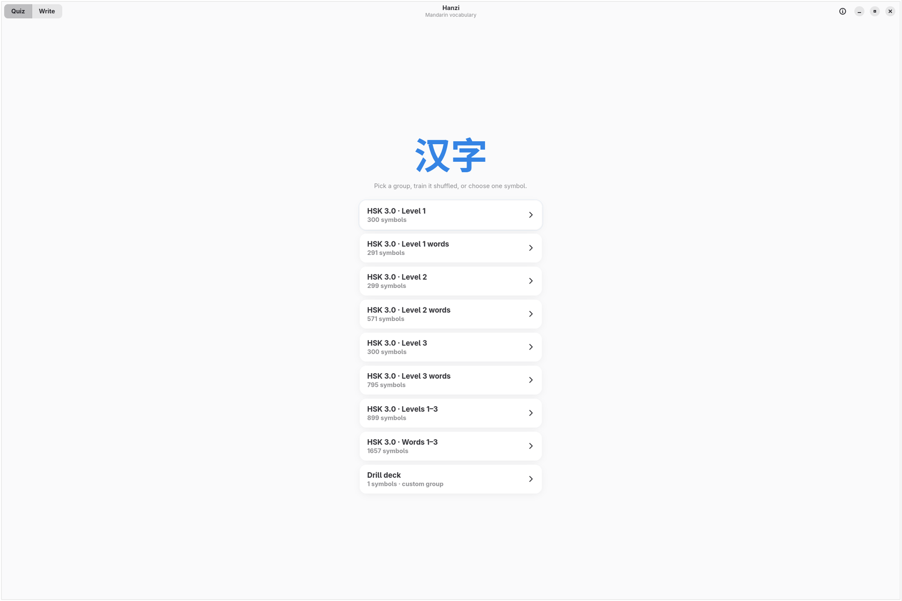
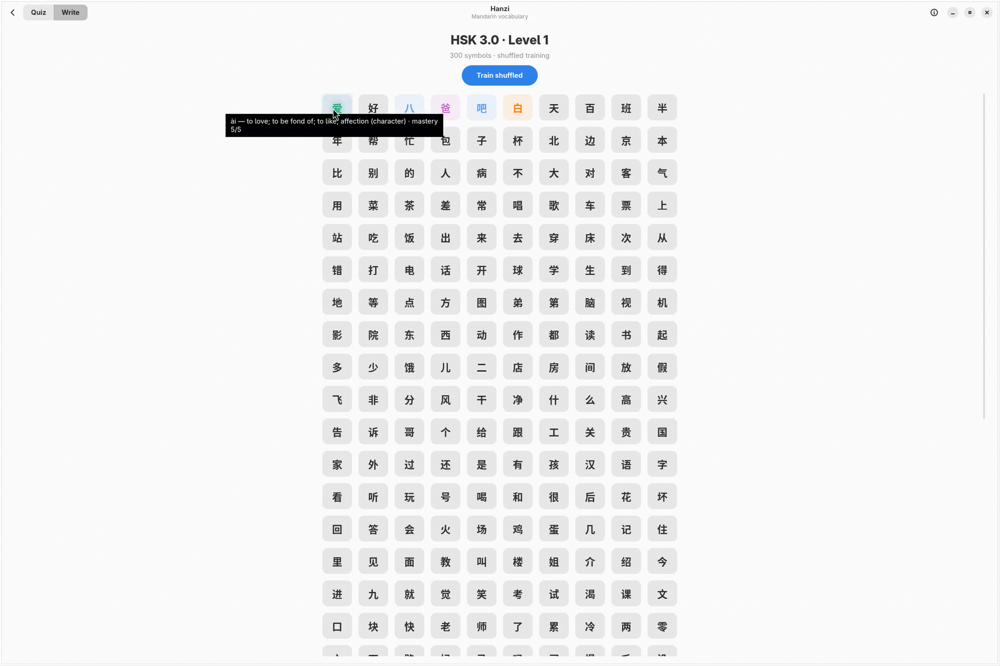
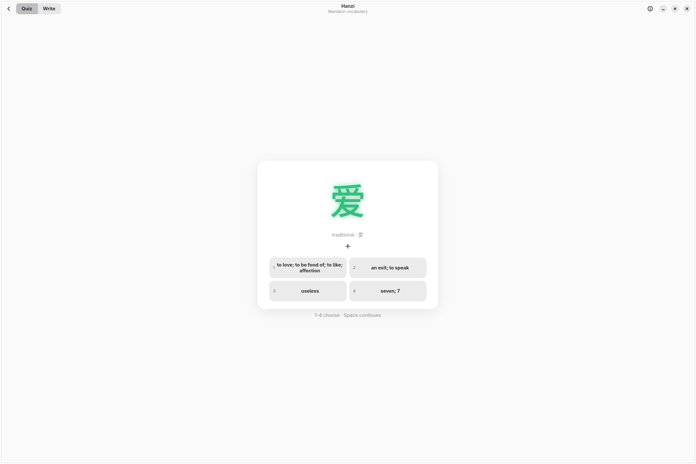
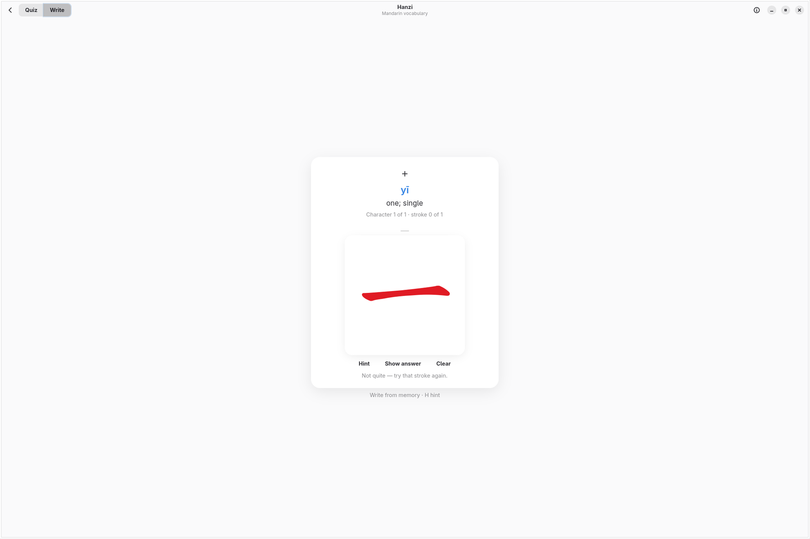
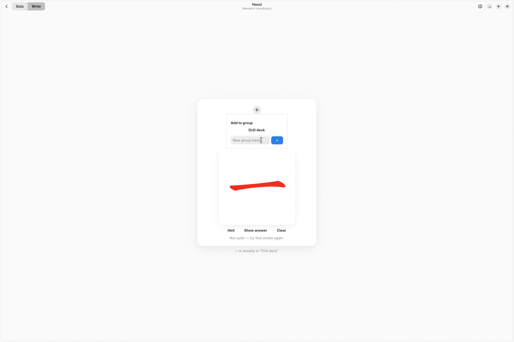

# Hanzi

A small, focused Mandarin vocabulary trainer for the Linux desktop, built with
Rust, GTK4, and libadwaita. Groups of characters and words are trained in
shuffled order, or any single entry can be picked independently. There are two
input modes — pick the translation or write the entry.

The deck follows the HSK 3.0 2025 syllabus and currently covers levels 1–5:
1,527 characters and 2,770 multi-character words.











## Requirements

- Rust 1.92+ (the repository pins 1.96.0 in `rust-toolchain.toml`)
- GTK 4, libadwaita 1.6+, `glib-compile-resources`
- No extra runtime dependencies
- No audio/TTS pipeline in this release; the deck is text-only

On Fedora:

```sh
sudo dnf install gtk4-devel libadwaita-devel glib2-devel
```

On Debian/Ubuntu:

```sh
sudo apt install libgtk-4-dev libadwaita-1-dev libglib2.0-dev
```

## Run

```sh
cargo run
```

Tests cover pinyin tone marks, tone sandhi, path parsing, and stroke matching:

```sh
cargo test
```

## Keyboard shortcuts

| Key | Action |
| --- | --- |
| `1`–`4` | Pick an answer in Quiz mode |
| `H` | Animate the next stroke in Write mode |
| `Space` / `Enter` | Continue after answering |

## Stroke data and writing practice

The demo bundles one JSON file per simplified character in `data/strokes/`,
named by Unicode code point (`4f60.json` for 你). Fetch missing characters with:

```sh
./tools/fetch_stroke_data.py
```

The data comes from
[hanzi-writer-data](https://github.com/chanind/hanzi-writer-data), derived from
[Make Me a Hanzi](https://github.com/skishore/makemeahanzi), and is distributed
under the Arphic Public License. The full text is in
`data/strokes/ARPHICPL.TXT`; attribution is also shown in the About dialog.
Traditional forms are not fetched yet.

In the app, switch the header control to **Write**. The card shows the pinyin
and translation, and the canvas starts empty; write each character of the word
from memory. **Hint** animates the next stroke, **Show answer** reveals the
character, and **Clear** restarts the current character. Accepted strokes fill
in; wrong strokes are counted and show the expected stroke briefly. The mode
reports correct/mistake feedback but does not schedule anything.

## License

Code is MIT. The HSK 3.0 deck is generated for this project. Stroke graphics
come from Make Me a Hanzi / hanzi-writer-data under the Arphic Public License;
the full text is in `data/strokes/ARPHICPL.TXT`. English glosses are derived
from CC-CEDICT (CC BY-SA 4.0); see `data/LICENSE-CC-CEDICT`. HSK 2025 levels
and cleaned definitions come from the HSKStory vocabulary dataset (CC BY-SA
4.0); see `data/LICENSE-HSK-2025`.
